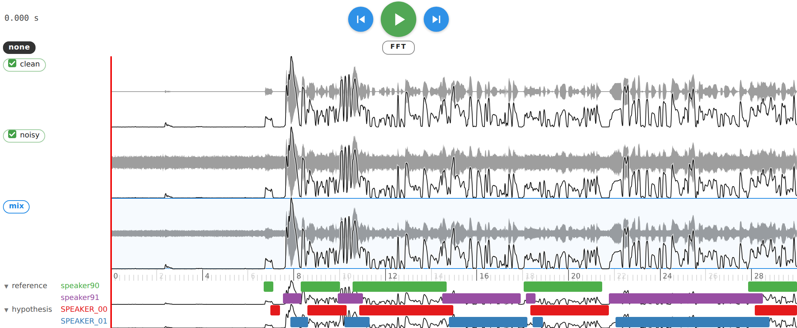
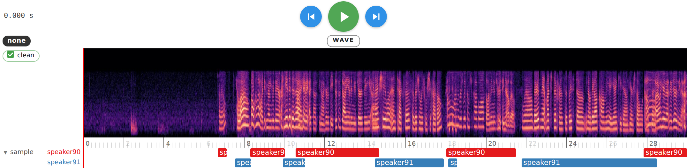
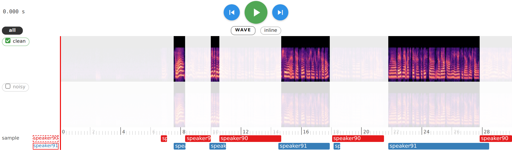
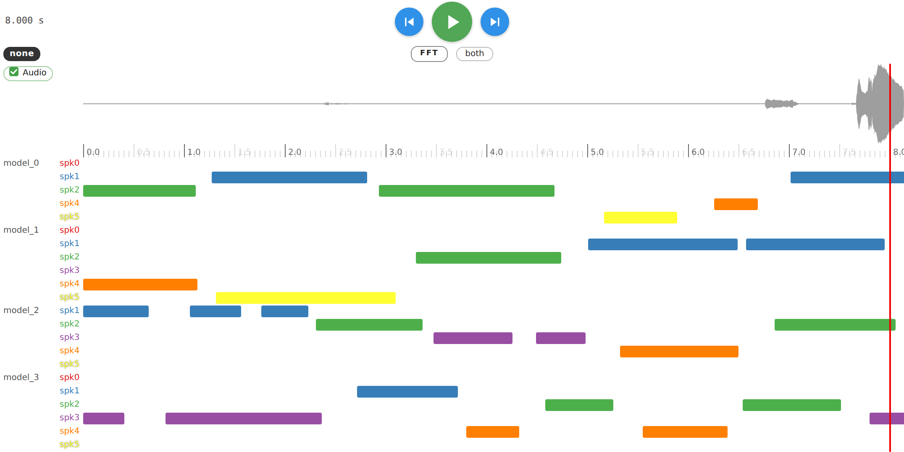
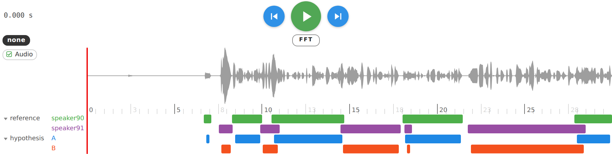
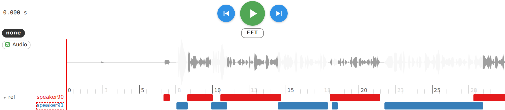
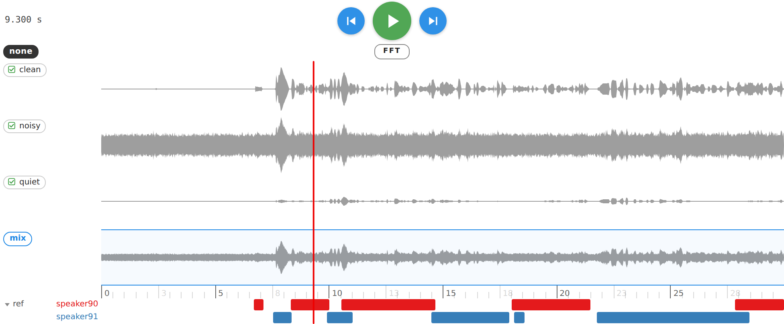
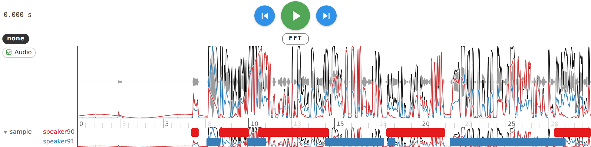
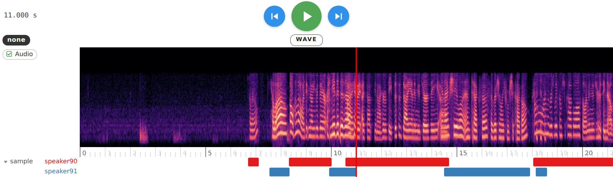

# WavLens

Interactive waveform, spectrogram, speaker-diarization lanes and a moving playhead, in Jupyter. pyannote-native, NeMo / WavLM aware, one `show()` call.

```bash
pip install wavlens                                                     # PyPI
pip install git+https://github.com/Michael-Soloveitchik/WavLens.git     # latest from GitHub
```

```python
import wavlens
wavlens.show("audio.wav", "audio.rttm")
```

Runtime dependencies (all installed automatically): anywidget, ipywidgets, traitlets, numpy, soundfile, pyannote.core, matplotlib, Pillow, scipy. Python ≥ 3.10, any Jupyter front end (JupyterLab, Notebook 7, VS Code).



Two audios (`clean`, `noisy`) and the framed `mix` row (the mean of the selected audios, what you hear), a reference and a hypothesis annotation, an RMS curve on every row, the chevron beside an annotation collapsing it to one row or expanding it to a row per speaker. Wheel = zoom around the pointer, click = seek, space = play/pause, ← / → = 10 ms. Every button is labelled with what its next click does.

```python
wavlens.show(audio={"clean": (x, sr), "noisy": (y, sr)},
             annotation={"reference": "audio.rttm", "hypothesis": pipeline(file)},
             function={"rms": rms}, expanded=["reference"])
```



`FFT` flips every audio row to a mel spectrogram computed in Python (every sample observed, silence dark). Zooming stretches the image, so it is instant. `fscale="linear"`, any matplotlib `colormap`.



Click a speaker or an annotation name: keep its segments → keep the complement → neutral. Active names intersect: here `speaker91` minus `speaker90`. Outside the result the audio is silent and whited out and the playhead skips. The `noisy` audio is muted with its checkbox and drops out of the mix; `all` / `none` toggle every audio; playback is the mean of the m selected audios (`weights=` for per-audio gains, still divided by m).



Any number of annotations and speakers: the lane block grows (`row_height`); the chevron beside a name collapses that annotation to a single row (all speakers stacked) or expands it to a row per speaker with labels; drag a name (or an audio's pill) to reorder; colours are deterministic (Set1, pyannote's palette) or yours via `colors={speaker: css}` (per annotation: a dict of such dicts).



Reference against hypothesis: `colors={"hypothesis": {"A": "#1e88e5", "B": "#f4511e"}}` keys the outer dict by annotation, the inner by speaker; `colors={speaker: css}` alone colours that speaker in every annotation.



The complement of `speaker91` (second click on its label, dashed outline): only the parts where it is not speaking stay audible and visible. `solo=["!ref/speaker91"]` gives the same from Python.



Three audios and the `mix` row, the mean of the selected ones at 1/m each. Muting one with its checkbox drops it from the mix instantly; the row disappears when fewer than two are selected.



`function={"vad": vad, "energy": rms, "f0": pitch}`: every curve min-max scaled to 0..1, any length, hover for the name. Keys equal to an audio name bind a curve to that row only.



Wheel zoom at 40 px/s on the spectrogram: the image is stretched, the ruler is recomputed, the playhead and lanes stay aligned. `zoom=40, time=10.2, view="fft"` reproduce it from Python.

## Inputs

- Audio: path, `{"audio": path}`, `{"waveform": tensor, "sample_rate": sr}`, `(array_or_tensor, sr)` (what `torchaudio.load` returns), lists and `{name: ...}` dicts. Integers scaled, any torch device. `sample_rate=` is an optional target; mixed rates resample to the highest.
- Annotations, as objects: pyannote `Annotation` / `Timeline` / `Segment` / `DiarizeOutput`, its `serialize()` dict, NeMo Sortformer `diarize()` lines, a NeMo manifest dict, `{start, end, speaker}` records (SegLST, WhisperX), `(start, end, label)` tuples, `{speaker: [(start, end), ...]}` dicts, RTTM text, HF `.logits` (WavLM), frame matrices `(T, K)`. As files: `.rttm`, `.uem`, `.lab` / `.txt`, `.json` / `.seglst`, NeMo `.jsonl`.
- Functions: any 1-D signal, `(T, K)` matrices, HF logits, `SlidingWindowFeature`; bound to one audio by name or drawn on every row; any length, frame-centre time convention.
- Python control: `w.seek`, `w.play`, `w.pause`, `w.enabled`, `w.solo_("ref", "!ref/speaker91")`, `w.dim(...)`, all also as `show()` arguments.
- Export: `w.save_html("run.html")` (self-contained, interactive, no kernel), `w.log_comet(experiment, step=epoch)`, `w.log_wandb("diarization", step=epoch)`.

Full reference: `FUNCTIONALITIES.md`. Fixed findings from the bug hunts: `FIXED_BUGS.md`. Blueprint: `plan.md`. Examples: `examples/wavlens.ipynb`, one cell per form. Hebrew documentation for Confluence, one page per notebook chapter with use cases: `confluence/`. Theory, comparison with other viewers and the feature roadmap: `theory.md`.

## Develop

```bash
pip install -e .                     # editable install, all runtime dependencies pulled in (see requirements.txt)
pip install -r requirements-dev.txt  # tests, notebook, build tools
npm install && npm run build        # after editing js/wavlens.js; restart the kernel afterwards
nice python3 tests/test_weights.py                                     # numeric checks
nice python3 tests/make_fixture.py && nice python3 tests/run_harness.py  # Playwright scenarios, screenshots in tests/out/
python -m build && twine check dist/*                                  # sdist + wheel for PyPI
```

MIT. Built on [wavesurfer.js](https://wavesurfer.xyz) and [anywidget](https://anywidget.dev).
